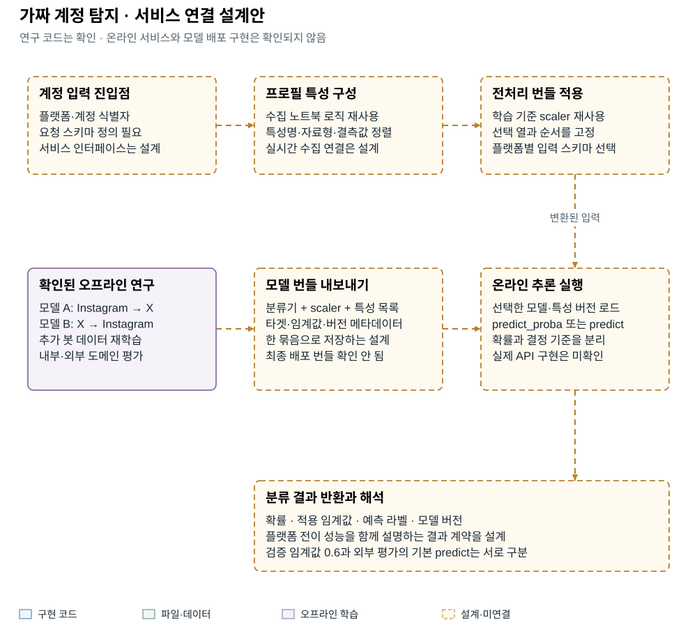
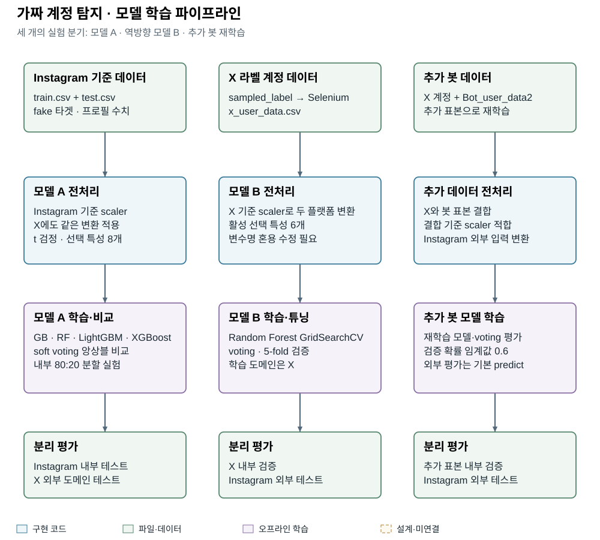

# 플랫폼 간 가짜 계정 분류

Instagram과 X의 계정 프로필 특성으로 가짜 계정을 분류하고 플랫폼 간 일반화 성능을 비교한 연구다. Instagram → X, X → Instagram, 추가 봇 데이터 재학습의 세 분기로 구성된다. 기록상 주요 실험은 2025년 5월 말부터 6월이다.

**크롤링은 팀원이 담당했고, 저는 수집 이후의 전처리·정규화·모델 학습을 담당했습니다.** PM으로 프로젝트 일정 조율과 핵심 기능 제안도 맡았습니다.

[프로젝트 소개 1쪽](docs/project_overview.pdf) · [데이터 수집과 모델 개발의 역할 구분](docs/contribution_scope.md)

## 본인 기여와 팀원 역할

| 참여자 | 담당 범위 |
|---|---|
| 본인 | PM · 수집 이후 전처리 · 정규화 · 모델 학습 |
| 팀원 | 계정 데이터 크롤링 |

`notebooks/collection`의 수집 노트북은 팀원 담당 영역의 자료입니다. 본인 기여는 수집된 데이터를 모델 입력으로 정리하고 플랫폼별 기준에 맞춰 변환한 뒤 분류 모델을 학습하는 과정입니다.

주요 코드: [기준 플랫폼 전처리](notebooks/01_prepare_instagram_to_x_features.ipynb), [역방향 전처리](notebooks/04_prepare_x_to_instagram_features.ipynb), [분류 모델](notebooks/03_train_instagram_to_x_model.ipynb), [추가 봇 데이터 재학습](notebooks/07_train_bot_augmented_model.ipynb).

## 대표 실험

기준 플랫폼의 scaler와 특성 선택 → 분류기·soft voting 학습 → 내부 검증 → 외부 플랫폼 평가로 진행했습니다. Instagram → X, X → Instagram, 봇 데이터 추가 재학습을 비교합니다. 추가 봇 모델의 내부 검증 정확도는 79.33%(임계값 0.6), Instagram 외부 평가 정확도는 69.68%(기본 predict)였습니다. 평가 데이터와 판정 조건이 다른 결과로 구분합니다.

## 실행 구성

`notebooks`의 번호 순서와 `collection`의 별도 수집 단계를 참고한다. 수집은 Selenium 로그인과 입력 라벨셋이 필요하고, 모델 연구는 데이터 CSV와 선택 특성 순서를 설정해야 한다.

온라인 분류 서비스와 최종 모델 번들 배포는 현재 구현 범위에 포함되지 않는다. 서비스 그림은 연구 결과를 추론으로 확장하기 위한 설계안이다.

## 아키텍처

## 대표 노트북

| 파일 | 목적 |
|---|---|
| [01_prepare_instagram_to_x_features.ipynb](notebooks/01_prepare_instagram_to_x_features.ipynb) | Instagram 학습 기준과 X 변환 |
| [02_validate_cross_platform_features.ipynb](notebooks/02_validate_cross_platform_features.ipynb) | 플랫폼과 모델 B별 특성 t 검정 |
| [04_prepare_x_to_instagram_features.ipynb](notebooks/04_prepare_x_to_instagram_features.ipynb) | X 학습 기준으로 플랫폼 변환 |
| [05_train_x_to_instagram_model.ipynb](notebooks/05_train_x_to_instagram_model.ipynb) | 모델 B 학습과 외부 테스트 |
| [07_train_bot_augmented_model.ipynb](notebooks/07_train_bot_augmented_model.ipynb) | 추가 봇 데이터 모델 B 프라임 |
| [03_train_instagram_to_x_model.ipynb](notebooks/03_train_instagram_to_x_model.ipynb) | 8개 선택 특성 모델 A 비교 |
| [06_prepare_bot_augmented_dataset.ipynb](notebooks/06_prepare_bot_augmented_dataset.ipynb) | 추가 봇 데이터 결합과 재학습 입력 |
| [01_resolve_x_usernames.ipynb](notebooks/collection/01_resolve_x_usernames.ipynb) | 라벨 ID에서 사용자명 추출 |
| [02_collect_x_profiles.ipynb](notebooks/collection/02_collect_x_profiles.ipynb) | 로그인 후 X 데이터 수집 |

## 데이터와 환경

대규모 데이터·가중치·인증 파일·가상환경은 별도로 준비합니다. 노트북의 실행 경로와 설정값은 사용하는 환경에 맞게 지정합니다. 노트북은 목적별로 선별하고 파일명을 정리했으며, 원래 파일명과 원본 수정 시점은 [노트북 대응표](docs/notebook_index.csv)에 기록했습니다.
